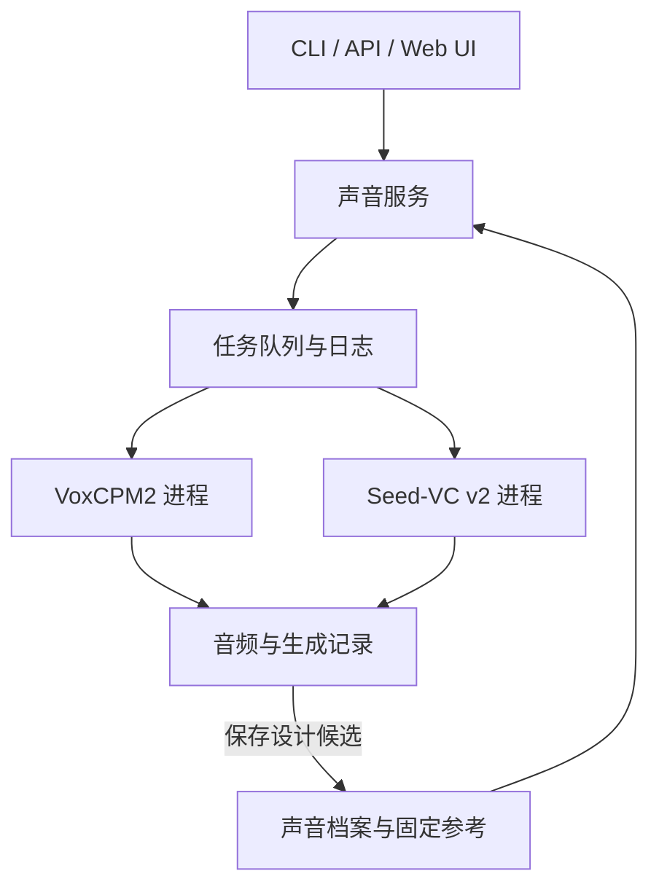

# 架构与数据契约

## 1. 服务和模型环境分离

主进程只负责界面、档案、音频统计、参数校验、任务排队及结果管理。VoxCPM2 和 Seed-VC 分别放在独立 Python 环境，通过明确的请求与结果 JSON 启动。这样可以处理不同的 PyTorch/CUDA/依赖版本，并让任务失败时保留可读日志。

进程划分是依赖隔离与运行管理方案，不是规避许可证的方法。整合项目选择 GPL-3.0-only；第三方部分保留自身许可，见 [LICENSING.md](LICENSING.md)。

## 2. 目录契约

下表的 `workspace/` 是工作目录示意；CLI 和 Windows 启动器实际默认使用 `data/`，也可通过 `--workspace` 指定其他目录。

| 路径 | 内容 |
|---|---|
| `src/rvcre/` | 主服务、CLI/API/UI、声音档案、任务管理及模型适配器 |
| `config/backends.json` | 本机后端配置；路径相对于该配置文件所在目录解析 |
| `.venv/` | 主应用和 CPU 开发测试环境 |
| `.venvs/voxcpm/` | VoxCPM 独立依赖环境 |
| `.venvs/seedvc/` | Seed-VC 独立依赖环境 |
| `third_party/VoxCPM/` | 固定 commit 的 VoxCPM checkout |
| `third_party/seed-vc/` | 固定 commit 的 Seed-VC checkout |
| `models/VoxCPM2/` | 已下载的本地基础模型；不放进 Git |
| `workspace/voices/<id>/` | 声音档案、原音和固定参考；`workspace` 可由运行参数更换 |
| `workspace/jobs/<id>/` | 输入请求、状态、日志、输出音频、结果元数据 |
| `workspace/datasets/<name>/` | 准备后的音频、训练/验证 JSONL 和数据报告，建议位置 |
| `workspace/training/<run>/` | LoRA 配置、调用计划、训练检查点和 TensorBoard，建议位置 |

声音档案内的 `reference_path`、`original_path` 使用相对路径，所以可整体搬移档案目录。任务记录包含实际执行时的绝对路径，适合追踪某次运行；迁移到另一台机器后应新建任务，不把旧绝对路径当成可直接复跑的凭据。

## 3. 声音档案

`profile.json` 保存名称、ID、版本、父档案、来源、参考选择方法、测量结果、设计意图和生成元数据。`original.*` 保留导入的音频，`reference.wav` 是本次保存的条件音频。

参考生成采用能量窗口选择：输入大于 12 秒时，选一个能量较高的 12 秒窗口；较短输入整体保留。它不是语音活动检测，也不保证自动选中最自然的完整句子。参考最短 3 秒，建议用户优先提供已经剪好的干净单人短句。背景音乐、叠音、重混响都可能进入条件信息。

当参考被截取时，原整段转写保留为 `source_transcript`，不会错误沿用为参考转写。Hi-Fi 克隆必须使用与实际参考逐字对应的文字；需要该模式时，重新导入已经剪好并准确标注的片段。

`design_spec_origin=defaults_not_measured` 表示 UI 初始值只是默认值；`requested` 表示用户指定了设计意图。导入录音且存在可靠 F0 中位数时，`pitch_hint_from_measurement` 表示仅对 `pitch` 给出粗略提示：小于 150 Hz 为 `low`，大于 240 Hz 为 `high`，其余为 `medium`。这些阈值是本应用的起始分区，不是对身份的判定；其余音色旋钮仍为默认值。三种来源都不意味着系统已客观反演全部声学性质。当前测量范围仍限于参考音频的可用 F0 与信号统计。

## 4. 后端职责

### VoxCPM2

- `design`：把用户设计意图编译为提示，生成多个候选。
- `tts`：使用档案里的同一份参考音频。可控模式允许表达提示；Hi-Fi 模式要求对应转写，并拒绝混入额外表达控制。
- 每个任务保存实际使用的随机种子与生成记录。固定种子有助于对照，但不保证跨设备、软件版本或底层算子得到逐样本一致的波形。

### Seed-VC v2

- 输入源录音和档案参考音频，输出纯音色转换结果。
- 固定 `convert_style=false`、`anonymization_only=false`。
- 首版 `length_adjust=1.0` 固定。已核实的上游纯音色分支不应用该长度参数，因此不能给用户一个看似可用的语速旋钮。
- 不依赖 ASR 转写；不重新把文字交给 TTS 念一遍。
- 不提供显式 F0 锁定，因此“保留表演”是目标和验收维度，不是逐帧无损承诺。

v0.1 为每项神经任务启动后端进程。常驻模型、批量复用神经提示缓存和调度优化在后续版本中实现；不要把第一次启动耗时与稳定常驻服务的延迟混为一谈。

## 5. 数据准备与训练路径

`prepare_dataset()` 先识别源文件和说话人，读取同名转写；只有用户启用转写时才使用本地 faster-whisper。短音频已有正确文字时不会加载 ASR。长音频只有整篇文字而没有时间对齐时，默认进入报告；不按字符数或时间比例拆文字。

ASR 返回的带时间戳片段可以合并为符合时长的训练样本，但始终保留 `source_id`。划分以说话人内的原始文件组进行，防止一个录音的不同切片同时进入训练和验证。参考选择优先同划分同说话人的另一个源文件，其次另一个片段；只有一个片段时使用 `ref_audio=null`。

生成的 JSONL 使用相对于清单所在目录的音频路径。已固定的 [上游 `data.py`](https://github.com/OpenBMB/VoxCPM/blob/4b8dd4440d33396b3f429201f8af0529b4d2c601/src/voxcpm/training/data.py)明确按 manifest 目录解析相对路径；包装脚本启动训练时传绝对 manifest 路径，避免受工作目录影响。

训练包装器读取上游真实的 v2 LoRA YAML，并用 AST 检查生成字段是否存在于实际 `train()` 签名。实际执行仍调用官方脚本，不复制一套训练循环，也不根据猜测的字段启动训练。

## 6. 可迁移与不可迁移的部分

可迁移的资产包括原音、参考音频、精确转写、来源记录、评测文本和用户描述。神经 embedding、声学 token、LoRA 权重与预训练 checkpoint 都依赖具体后端和模型版本。

现有 RVC `.pth/.index` 可以在未来的 RVC 适配器里尝试兼容；它们不能直接装进 VoxCPM2 或 Seed-VC。文件扩展名相同不表示架构相同。新的统一 API 也不意味着内部模型权重已经融合。
